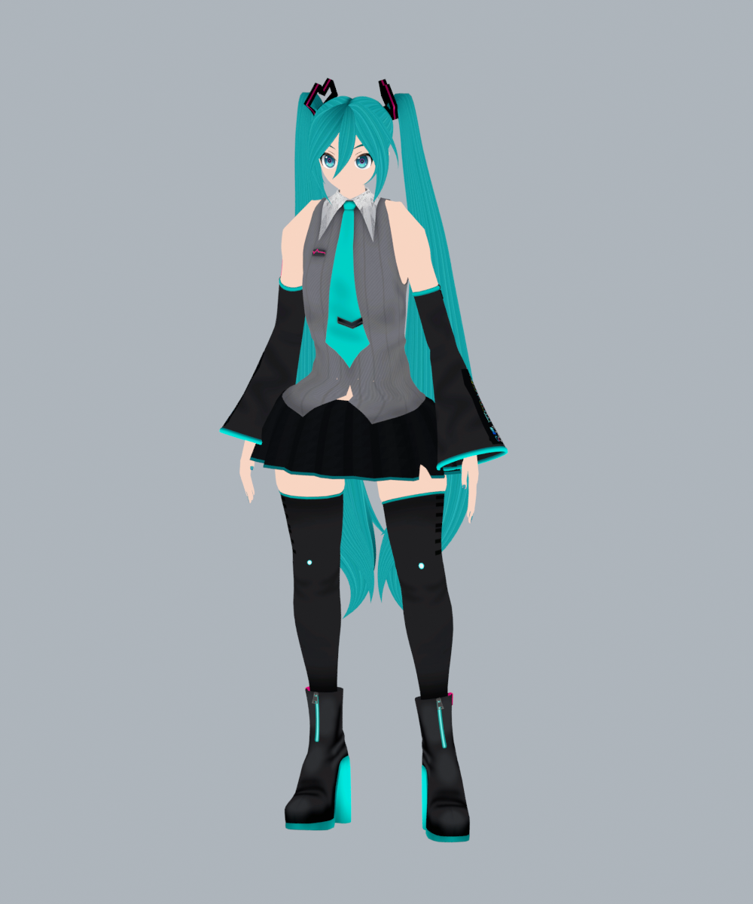
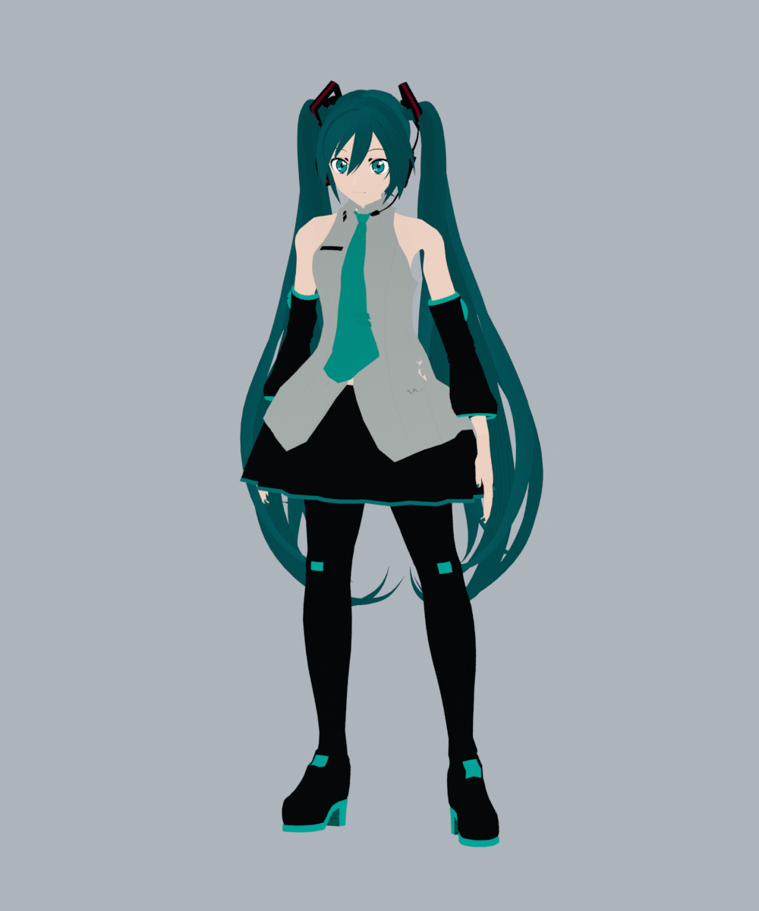
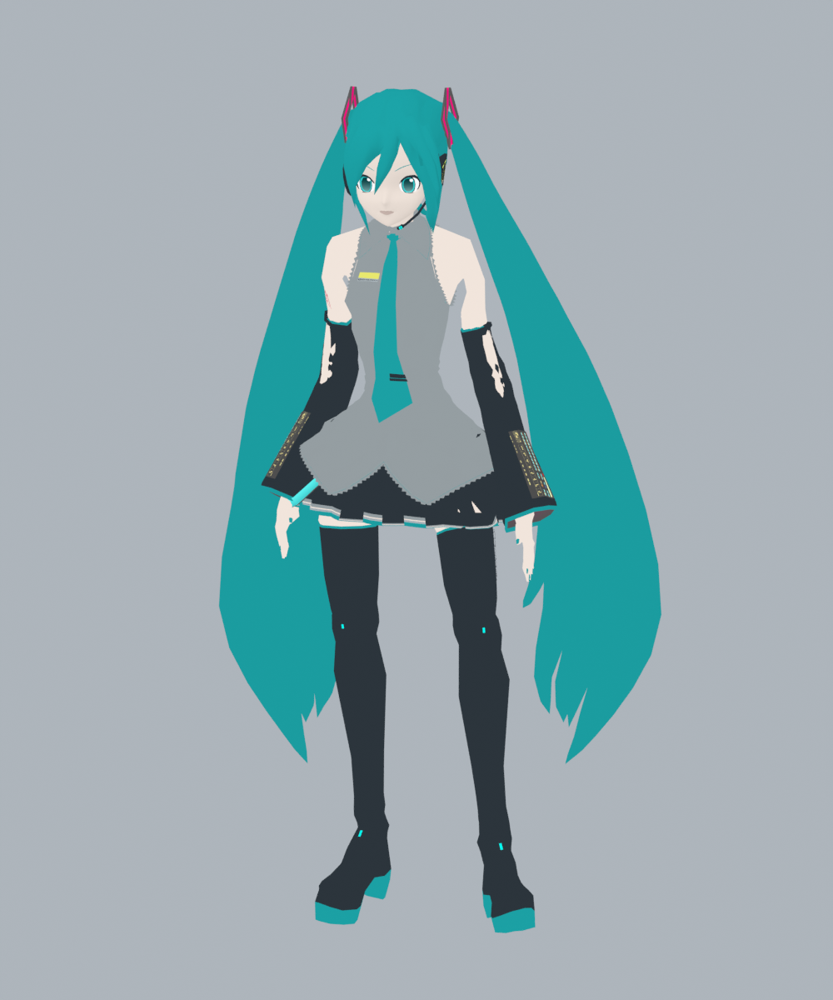
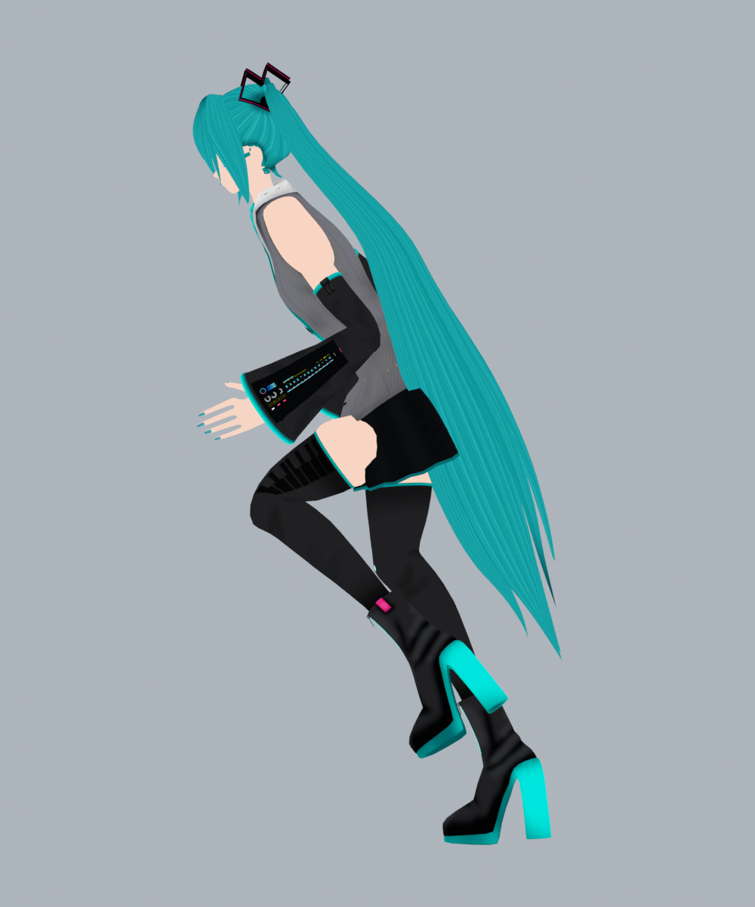
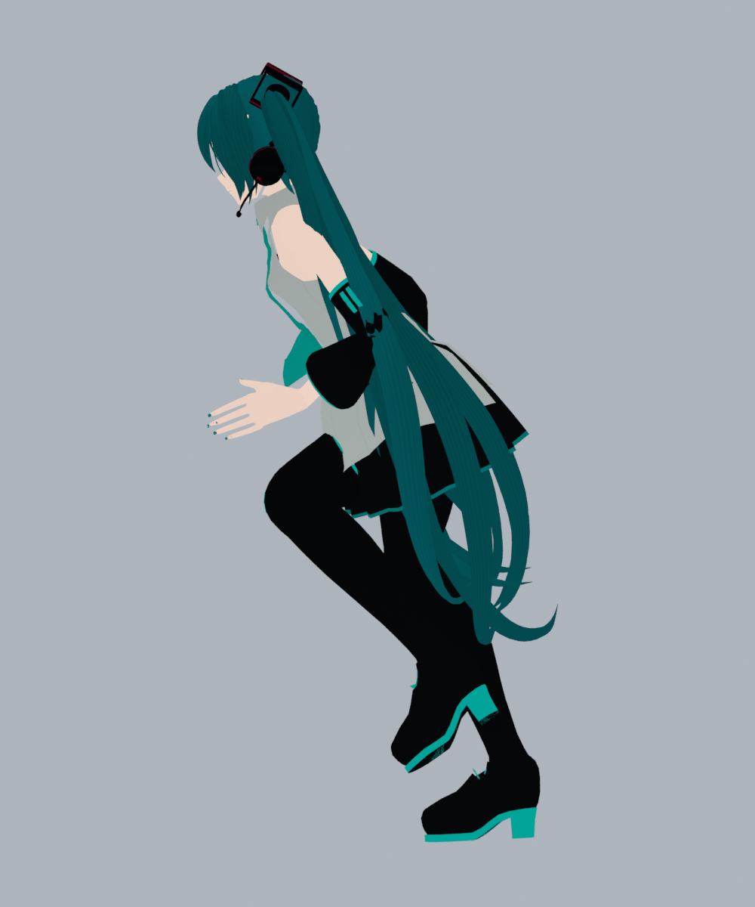
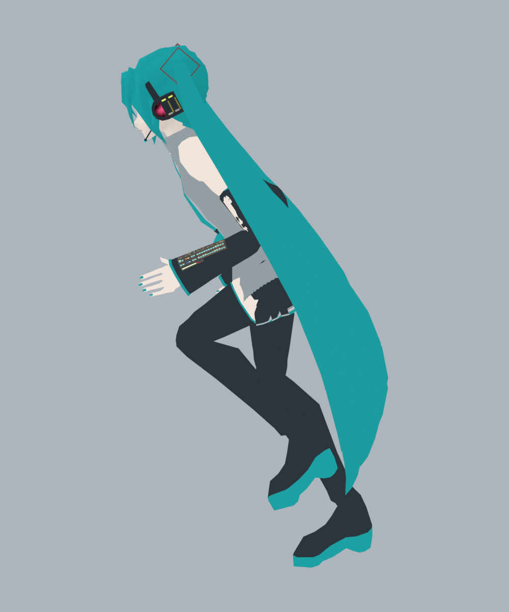
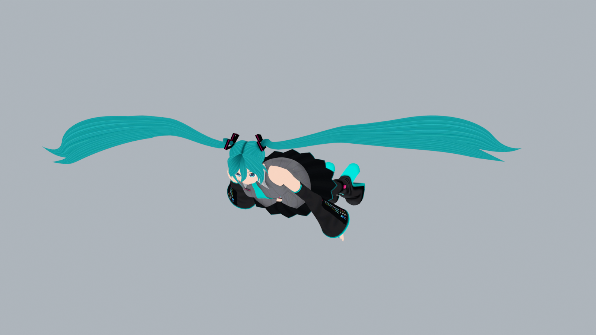
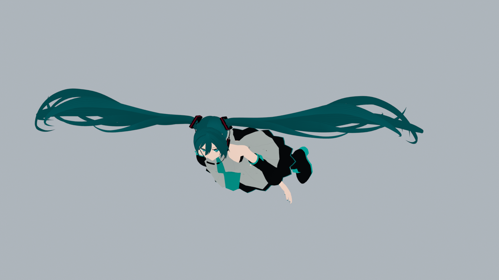
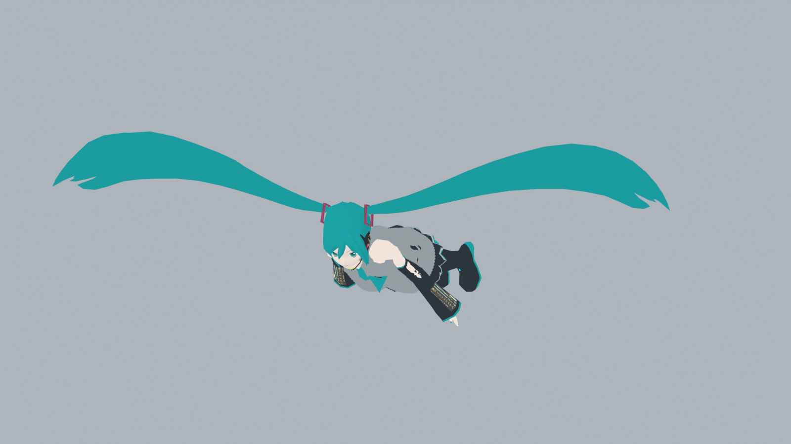

# Miku Glider

Adds 3 **Hatsune Miku skins for Glider**.

Choose **Hatsune Miku v1**, **v2** or **v3** in Glider's skin selection.

## Controls

- **J**: cycle first person, free orbit and shoulder camera.
- **K**: show or hide your weapon.

Change the keys in `BepInEx/config/horse.mycopunk.mikuglider.cfg`. Set a key to `None` to disable it. Restart the game after editing.

## Idle

| Hatsune Miku v1 | Hatsune Miku v2 | Hatsune Miku v3 |
|:---:|:---:|:---:|
|  |  |  |

## Running - side view

| Hatsune Miku v1 | Hatsune Miku v2 | Hatsune Miku v3 |
|:---:|:---:|:---:|
|  |  |  |

## Flight

| Hatsune Miku v1 | Hatsune Miku v2 | Hatsune Miku v3 |
|:---:|:---:|:---:|
|  |  |  |

*Model renders. Appearance may vary in game.*

[View all artwork](https://github.com/Gelofrat/MikuGlider/tree/main/arts) - [Credits](https://github.com/Gelofrat/MikuGlider/blob/main/ATTRIBUTION.md)
