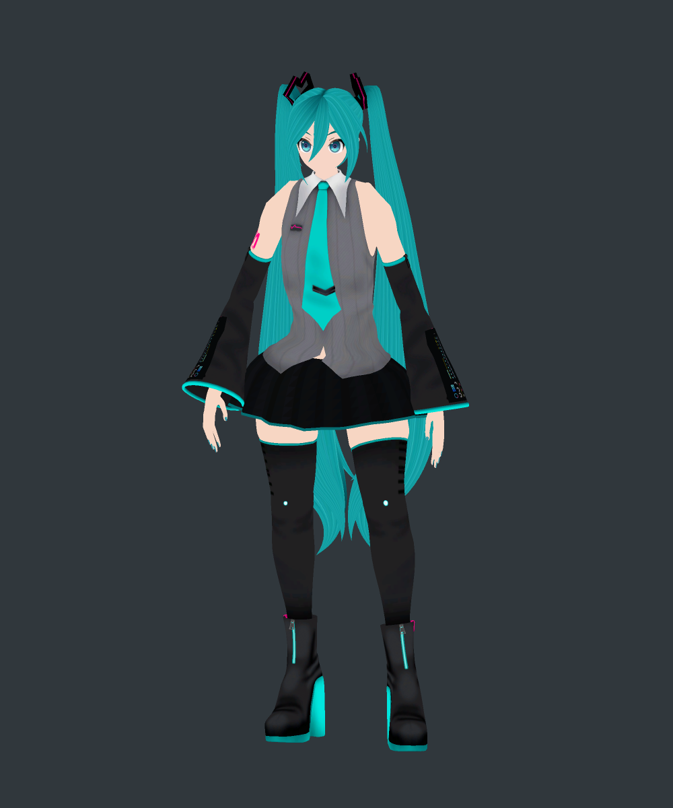
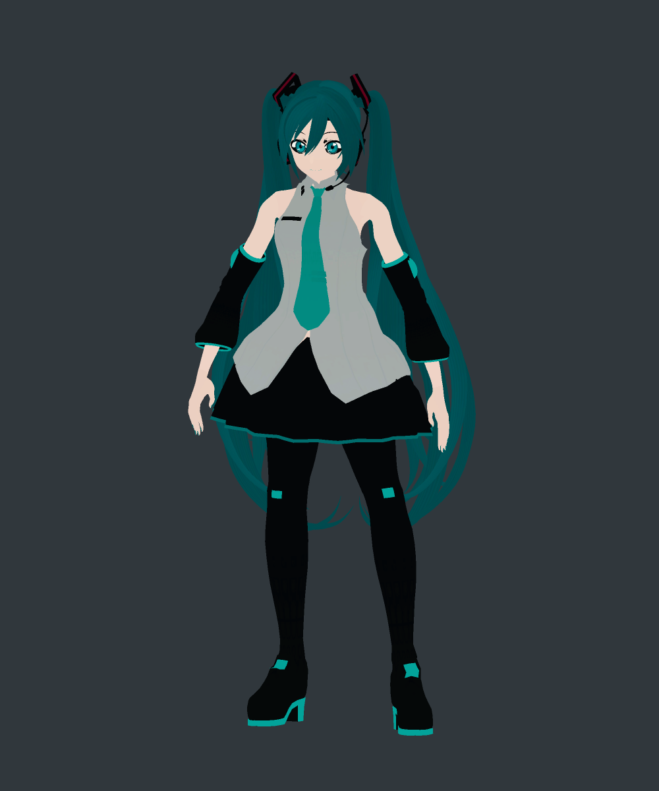
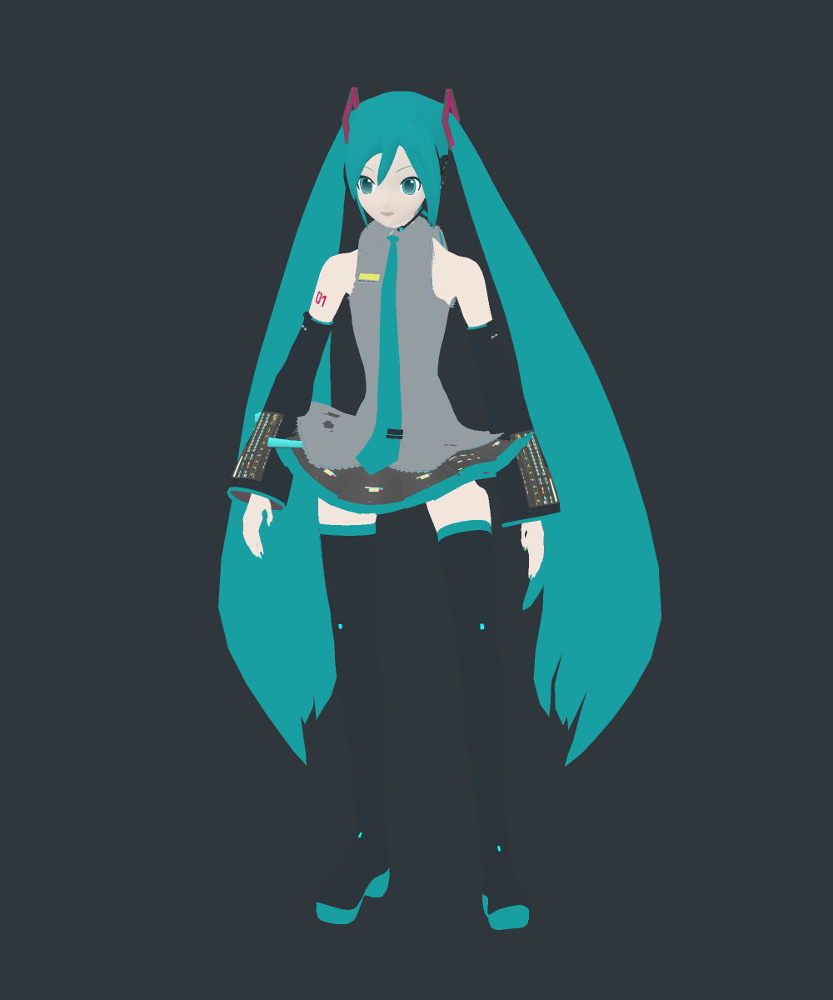
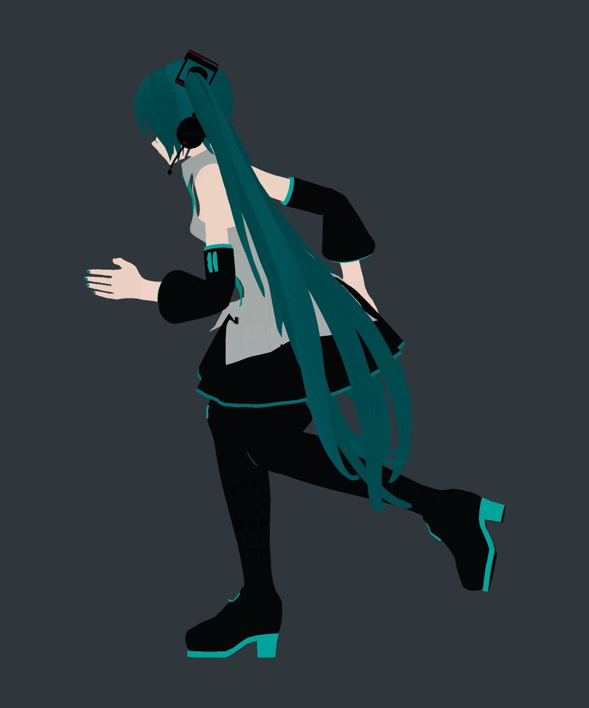
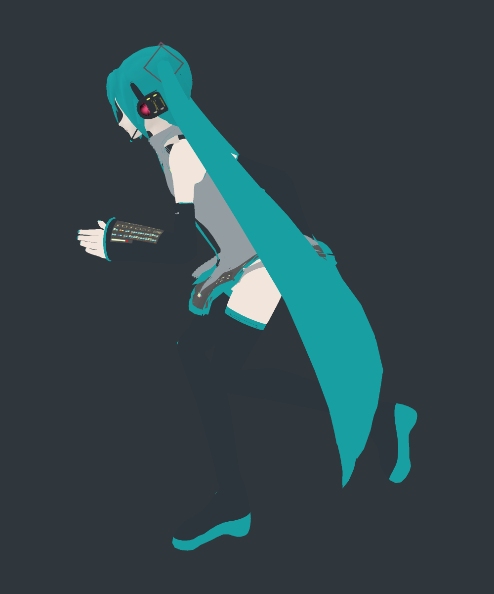
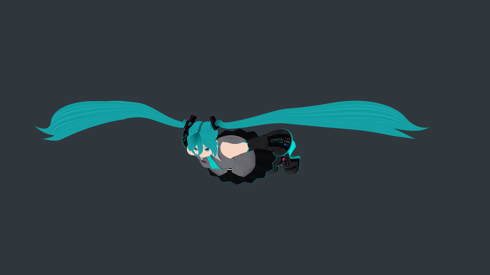
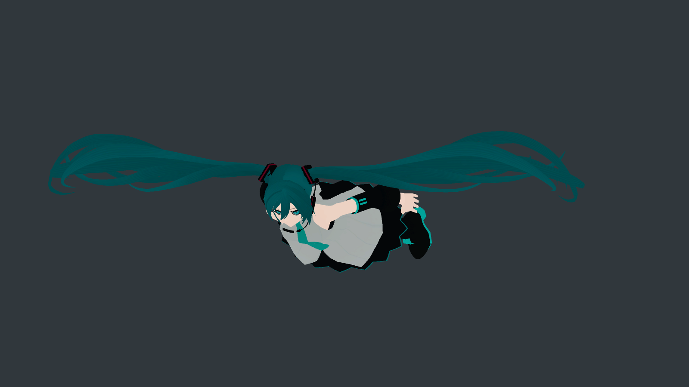
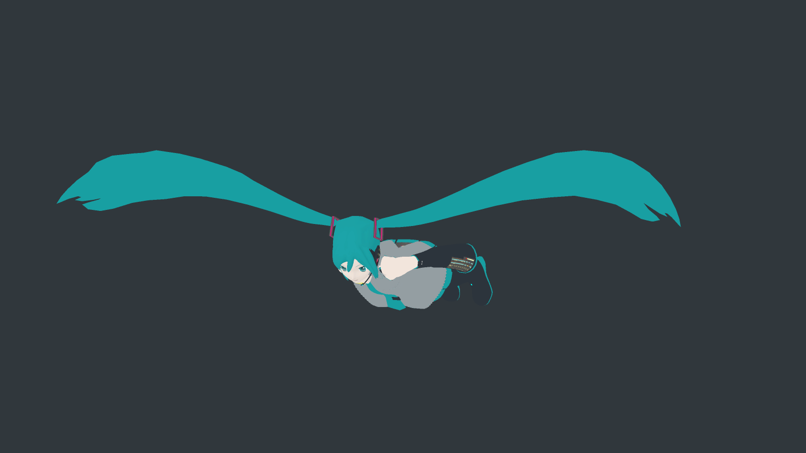

# Miku Glider

Adds 3 **Hatsune Miku skins for Glider**.

Choose **Hatsune Miku v1**, **v2** or **v3** in Glider's skin selection.

Equip **Porcelain Mask** from the shared hat inventory. It fits all three Miku skins and the five base characters.

## Controls

- **J**: cycle first person, free orbit and shoulder camera.
- **K**: show or hide your weapon in third person.

Change the keys in `BepInEx/config/horse.mycopunk.mikuglider.cfg`. Set a key to `None` to disable it. Restart the game after editing.

## Mission intro sound

When the first main objective displays **KILL**, there is a 50% chance to hear **Dalek: Exterminate** through the game's Wwise audio engine. This includes **Amalgamation Hunt** as well as Regulated Rampage; eligibility follows the objective title, not its class. It plays locally, at most once per mission, for any selected skin. Other objective messages and later kill objectives do not trigger it. Each attempt is recorded in the BepInEx log as `roll=play`, `roll=skip`, or disabled by config.

To disable it, set `EnableDalekMissionIntro = false` in the `[Audio]` section of `BepInEx/config/horse.mycopunk.mikuglider.cfg`, then restart the game. The audio is included in the mod DLL; no external player or runtime FFmpeg installation is needed.

## Idle

| Hatsune Miku v1 | Hatsune Miku v2 | Hatsune Miku v3 |
|:---:|:---:|:---:|
|  |  |  |

## Running - side view

| Hatsune Miku v1 | Hatsune Miku v2 | Hatsune Miku v3 |
|:---:|:---:|:---:|
|  |  |  |

## Flight

| Hatsune Miku v1 | Hatsune Miku v2 | Hatsune Miku v3 |
|:---:|:---:|:---:|
|  |  |  |

*Model renders. Appearance may vary in game.*

[View all artwork](https://github.com/Gelofrat/MikuGlider/tree/main/arts) - [Credits](https://github.com/Gelofrat/MikuGlider/blob/main/ATTRIBUTION.md)

## Building and adding a skin

Set `MYCOPUNK_GAME_ROOT` to a Mycopunk installation with BepInEx, then run `dotnet build MikuGlider.csproj -c Release` from the repository root. The plugin is written to `bin/Release/dist/Gelofrat-MikuGlider-<version>.dll`.

1. Add a variant with a unique key and upgrade ID. Keep `0x4D494B58` reserved for the older v3 ID and `0x4D494D41` for Porcelain Mask. [Skin catalog](src/Skins/SkinCatalog.cs)
2. Follow the v2 resource entries for `Model`, `Definition`, `Corrections`, `Texture.BodyAlbedo`, `Texture.FaceAlbedo` and `Texture.Icon`. A skin with no corrections can use `{"schemaVersion": 1, "meshes": []}`. Animated hair also needs the `Hair` resource and both tail meshes. [Resource names](MikuGlider.csproj) · [Mesh requirements](src/Skins/SkinFactory.cs)
3. For a pose-driven skirt, set `poseSkirt: true` and supply a separate `skirt` mesh bound to the native body skeleton. The standard build includes a `SeatedPose` track for each Miku skin. The emote wheel uses these tracks for the descent and seated loop. Other seats and skins without a matching track use procedural hand contact. If palm contact falls back to wrist and finger probes, `preserveSeatedHandHeading` in `definition.json` controls whether the wrist keeps its animated orientation. It defaults to `true`. [Garment and hand updates](src/Physics/SkirtGarmentVisual.cs)
4. Add a mesh named exactly after the variant key to `assets/porcelain-mask/porcelain.mikumesh`. Each fit has one submesh and zero bind poses. The shared mask validates all fits at registration. [Mask loader](src/Skins/PorcelainMask.cs)
