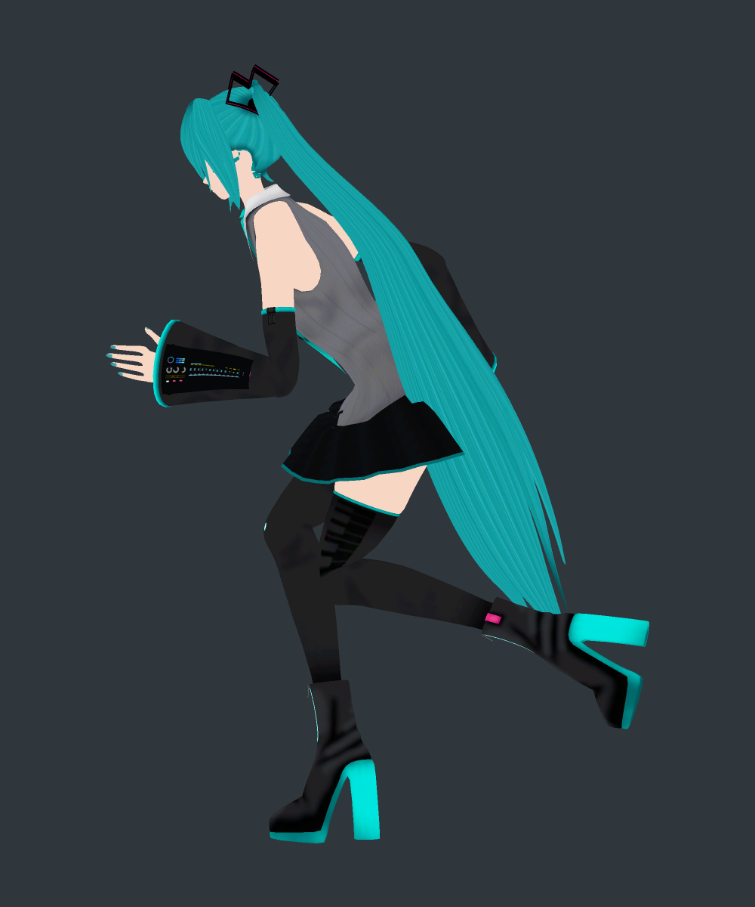

# Miku Glider

Adds 3 **Hatsune Miku skins for Glider**.

Choose **Hatsune Miku v1**, **v2** or **v3** in Glider's skin selection.

## Controls

- **J**: cycle first person, free orbit and shoulder camera.
- **K**: show or hide your weapon in third person.

Change the keys in `BepInEx/config/horse.mycopunk.mikuglider.cfg`. Set a key to `None` to disable it. Restart the game after editing.

## Mission intro sound

When the first main objective displays **KILL**, there is a 50% chance to hear **Dalek: Exterminate** through the game's Wwise audio engine. This includes **Amalgamation Hunt** as well as Regulated Rampage; eligibility follows the objective title, not its class. It plays locally, at most once per mission, for any selected skin. Other objective messages and later kill objectives do not trigger it. Each attempt is recorded in the BepInEx log as `roll=play`, `roll=skip`, or disabled by config.

To disable it, set `EnableDalekMissionIntro = false` in the `[Audio]` section of `BepInEx/config/horse.mycopunk.mikuglider.cfg`, then restart the game. The audio is included in the mod DLL; no external player or runtime FFmpeg installation is needed.

## Idle

| Hatsune Miku v1 | Hatsune Miku v2 | Hatsune Miku v3 |
|:---:|:---:|:---:|
|  |  |  |

## Running - side view

| Hatsune Miku v1 | Hatsune Miku v2 | Hatsune Miku v3 |
|:---:|:---:|:---:|
|  |  |  |

## Flight

| Hatsune Miku v1 | Hatsune Miku v2 | Hatsune Miku v3 |
|:---:|:---:|:---:|
|  |  |  |

*Model renders. Appearance may vary in game.*

[View all artwork](https://github.com/Gelofrat/MikuGlider/tree/main/arts) - [Credits](https://github.com/Gelofrat/MikuGlider/blob/main/ATTRIBUTION.md)

## Runtime maintenance

`ModRuntime` keeps registered skins alive while session features (camera and mission audio) can be stopped and resumed. Skin asset failures do not disable mission audio. Inventory grants are checked after collection, saved once per batch, and retried after five seconds if collection or saving fails. Pending saves remain associated with their profile.

For hand corrections, `ModelCorrectionMeshes` owns mesh preparation and asset validation; `ModelPoseCorrections` evaluates poses against the native skeleton. `RendererBoneBinding` applies the ordered native/wrist/grip layers and preserves newer game-side bindings during cleanup. The wrist transition updates after the corrected palm when that palm is overridden. Mesh rejection and renderer skeleton rejection use separate caches. Correction profiles are immutable after loading; authoring tools must use a fresh mesh when changing a prepared profile.

Before native skin replacement, temporary wrist and grip bindings are released for player models and character/gear previews. Reusing a mesh also checks the actual source bones; a new skeleton must receive new correction transforms. `LabSkinBindingChecks.Run()` and `.Arms()` exercise skin switches, inactive models, replacement rigs, and new renderers using already-prepared meshes.

Mission audio separates eligibility (`MissionIntroContext`), one attempt per mission (`MissionIntroChance`), orchestration (`DalekMissionAudio`) and native PCM playback (`DalekPlayback`). The probability remains 50%.

The project file is authoritative for the version and embedded resources. Placeholder specular textures are retained as source assets but are not loaded or packaged by the unlit materials. The [Unity lab setup](simulation/SETUP.md) includes model inspection and the artwork export workflow.

Run the regression checks from PowerShell with a .NET 10 SDK and the game/BepInEx installed:

```powershell
powershell -NoProfile -ExecutionPolicy Bypass -File tests/Run.ps1 -GameRoot 'C:\Apps\Steam\steamapps\common\Mycopunk'
```

These checks cover failure/retry paths, camera subscription lifetime, session enable/disable, Harmony targets and arguments against the installed game assembly, embedded resource hashes, audio configuration, objective filtering, chance and PCM callbacks. They do not execute native Wwise playback. The Unity stand additionally exposes `LabArchitectureChecks.Run()` for actual mesh/bone binding lifecycle checks. Recorded hand fixtures must load their matching `.mikumesh` file together with their correction profile; mixing old vertices with current bind poses or topology is invalid.
