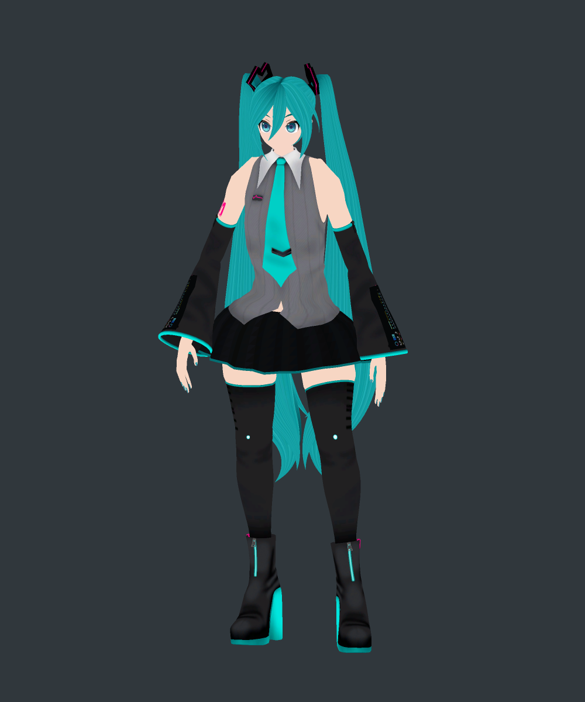
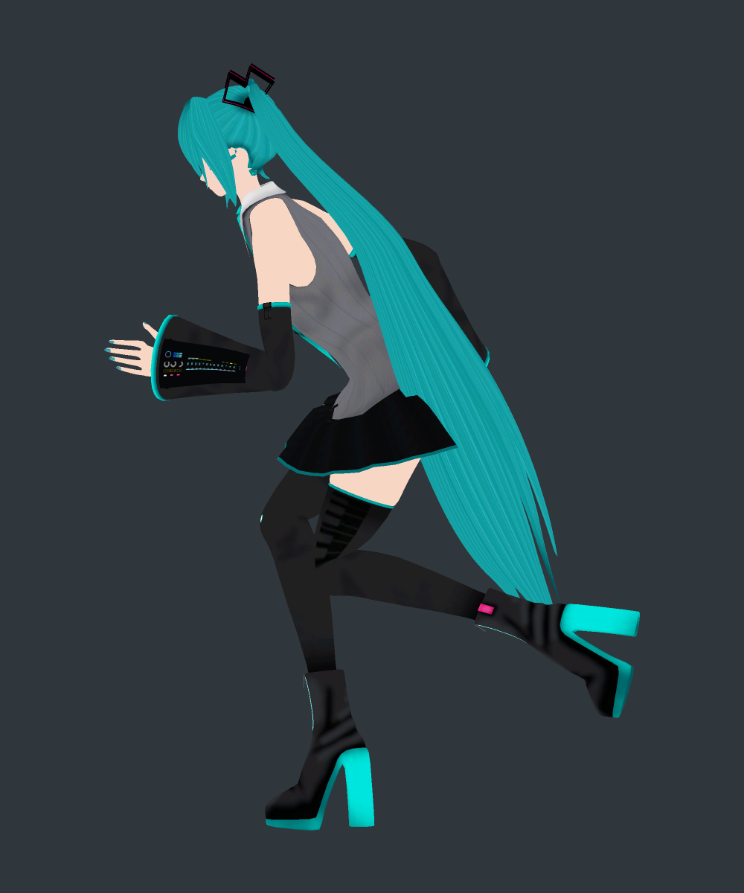
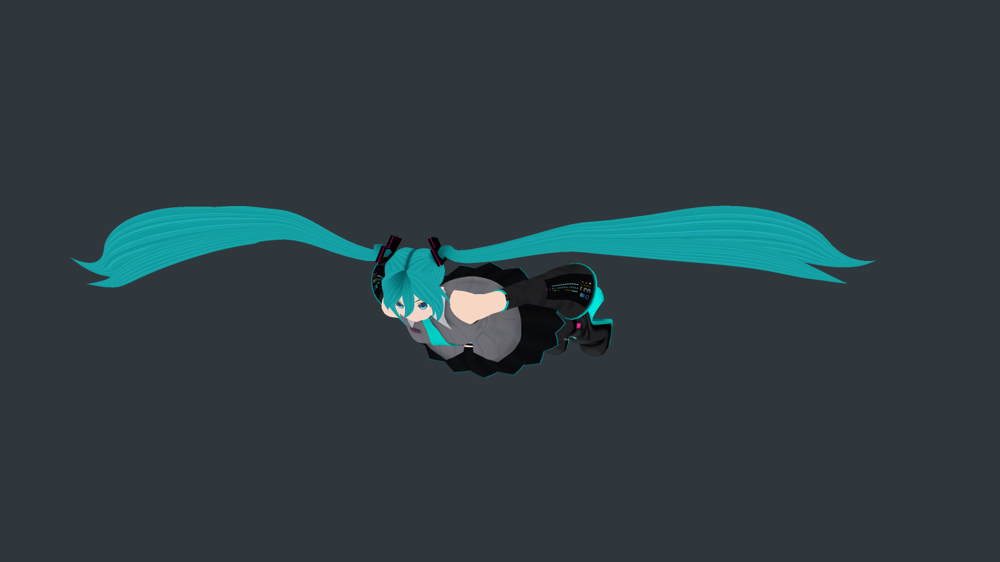
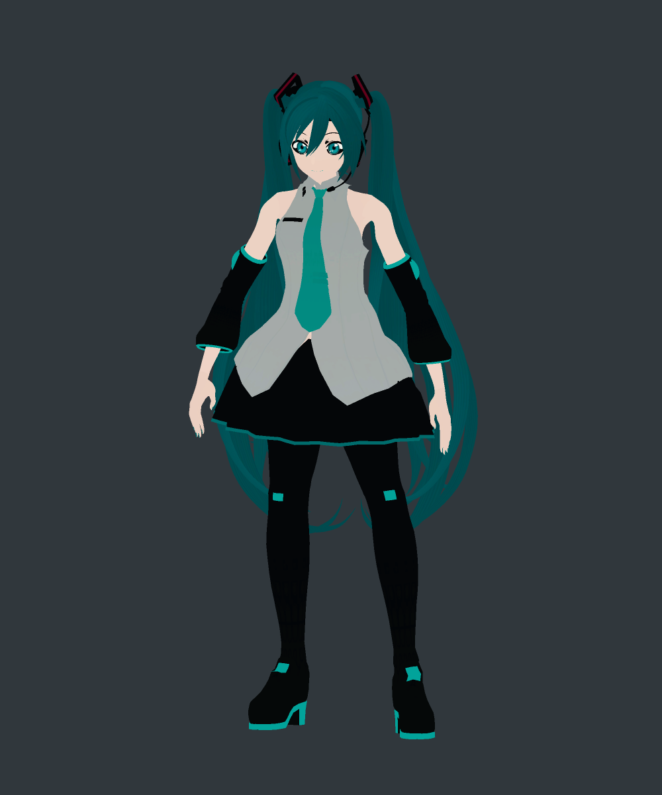
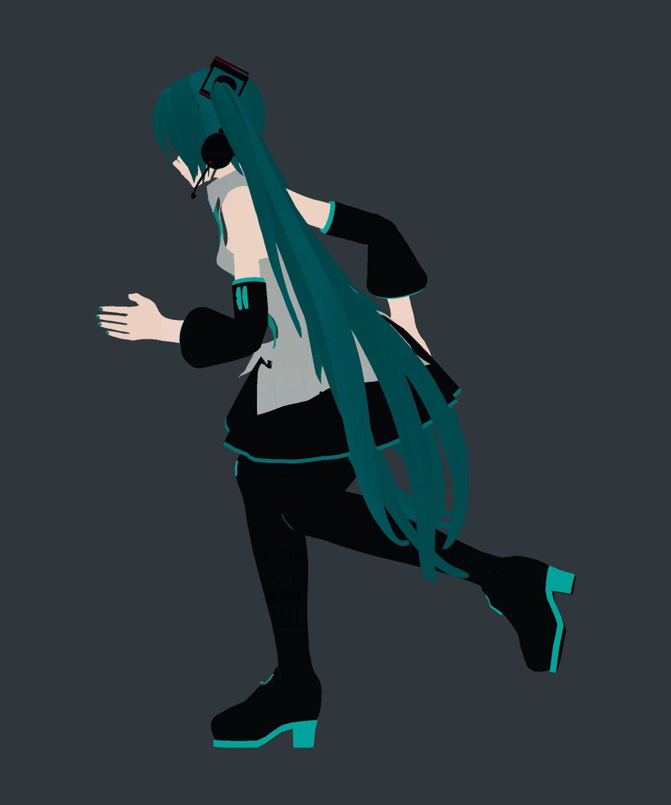
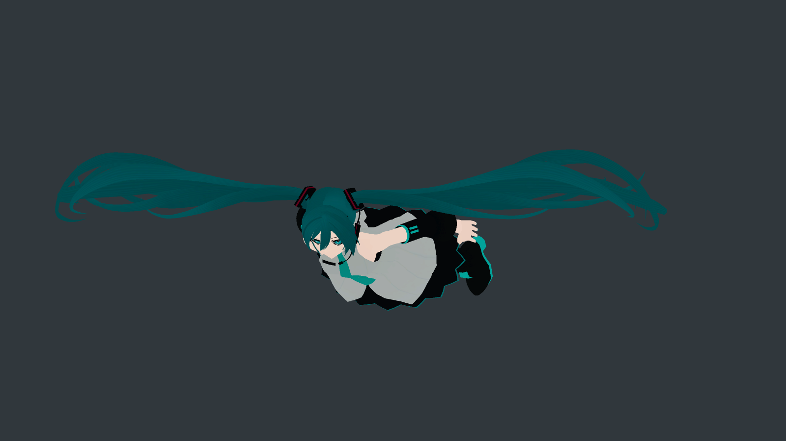
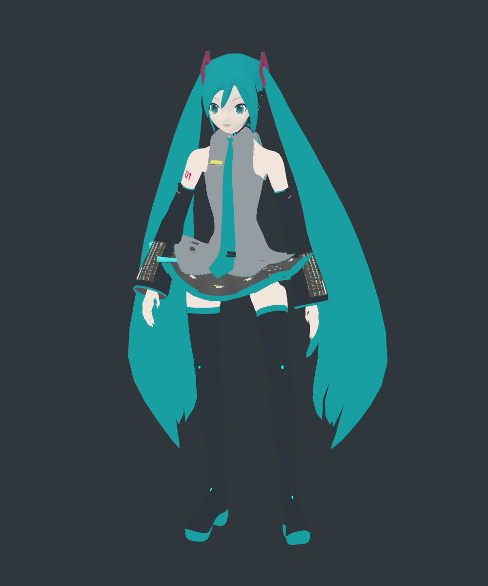
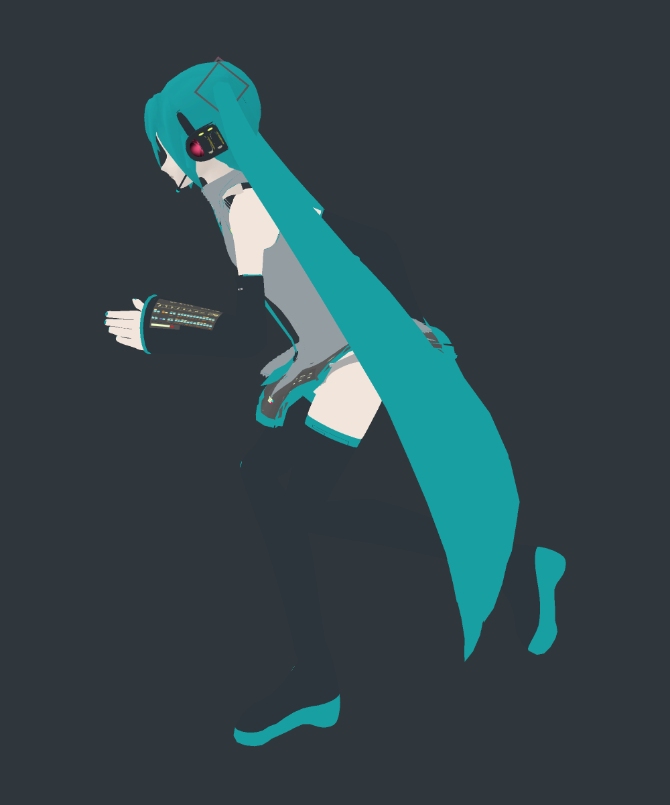
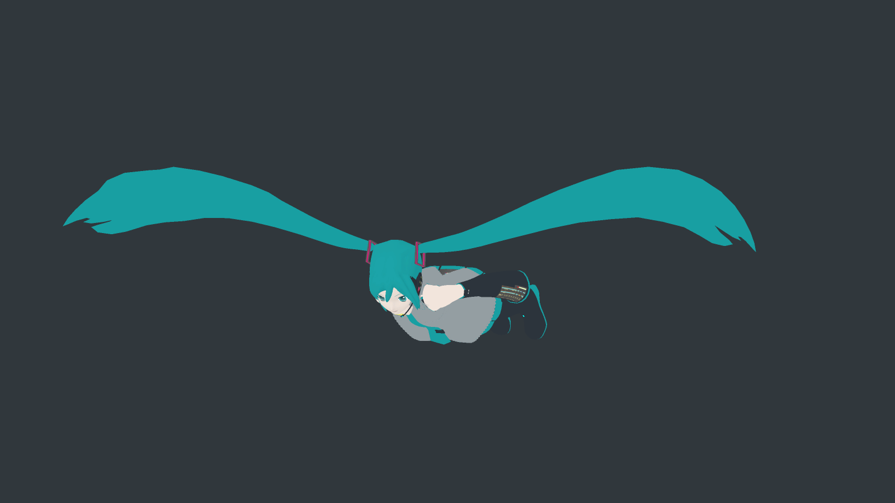
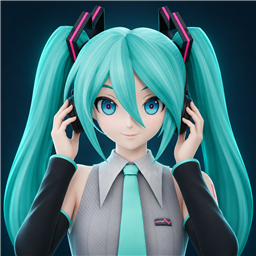

# Miku Glider artwork

Three skins, shown idle, running from the side, and in flight. These are model renders, not gameplay screenshots.

Updated for 0.12.37 using current model resources, Unity skinning, pose garments and the lab's albedo shader, with 2× supersampling. The package icon and full-size icon artwork are unchanged. [Render inputs and hashes](render-manifest.json) · [Reproduction instructions](../simulation/SETUP.md).

## Hatsune Miku v1

## Hatsune Miku v2

## Hatsune Miku v3

## Icon

Promotional artwork based on Hatsune Miku v1. [Full-size artwork](miku-icon-full.png).

[Model credits](../ATTRIBUTION.md)
