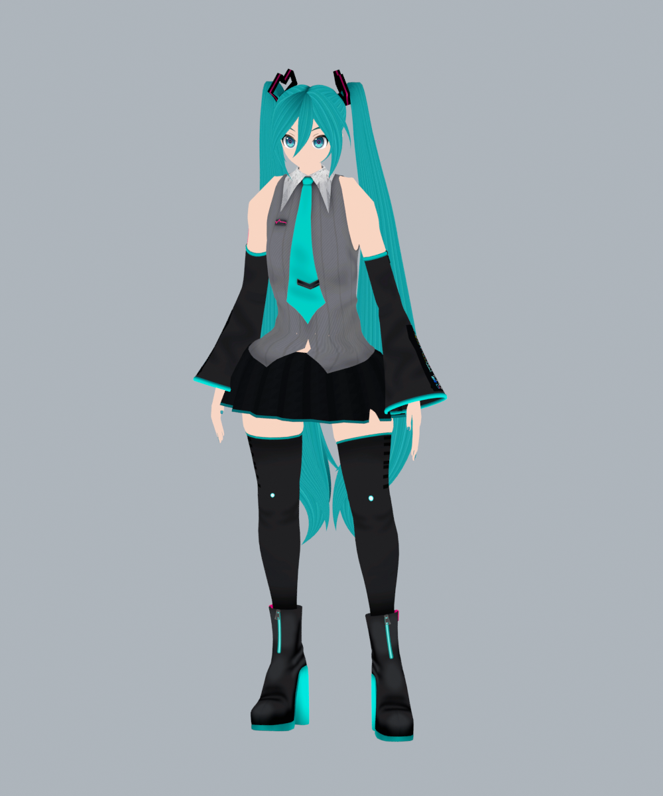
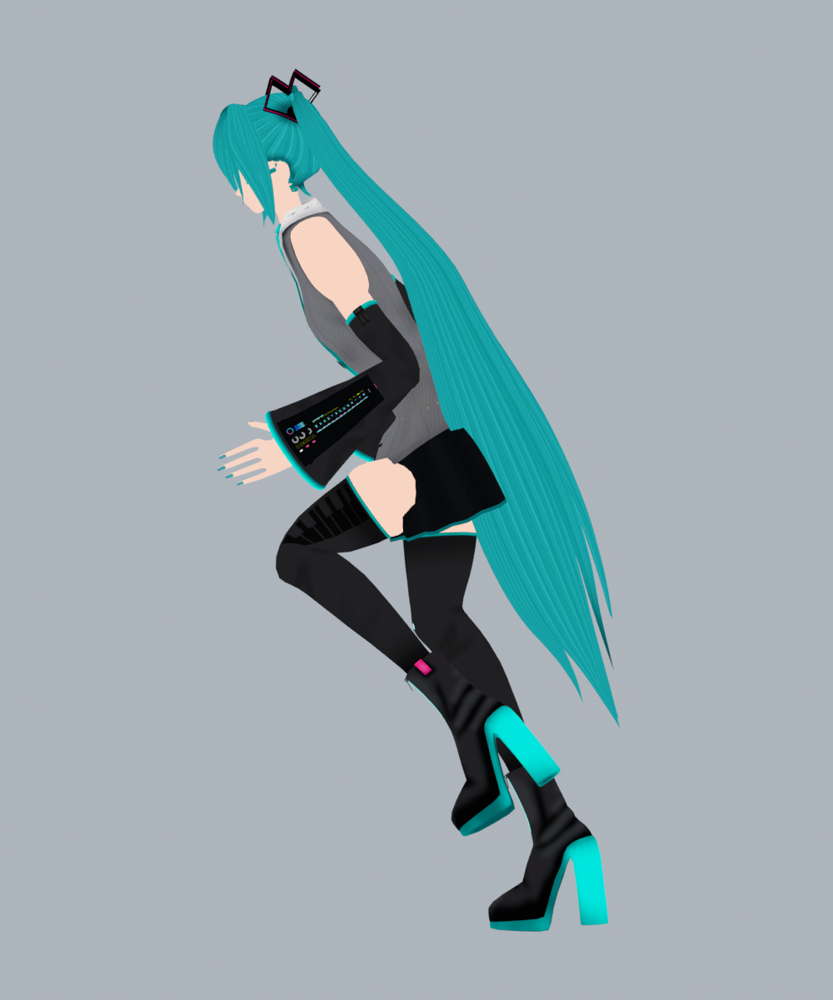
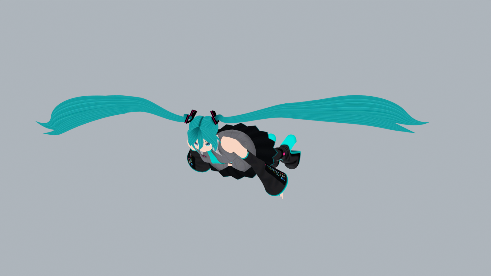
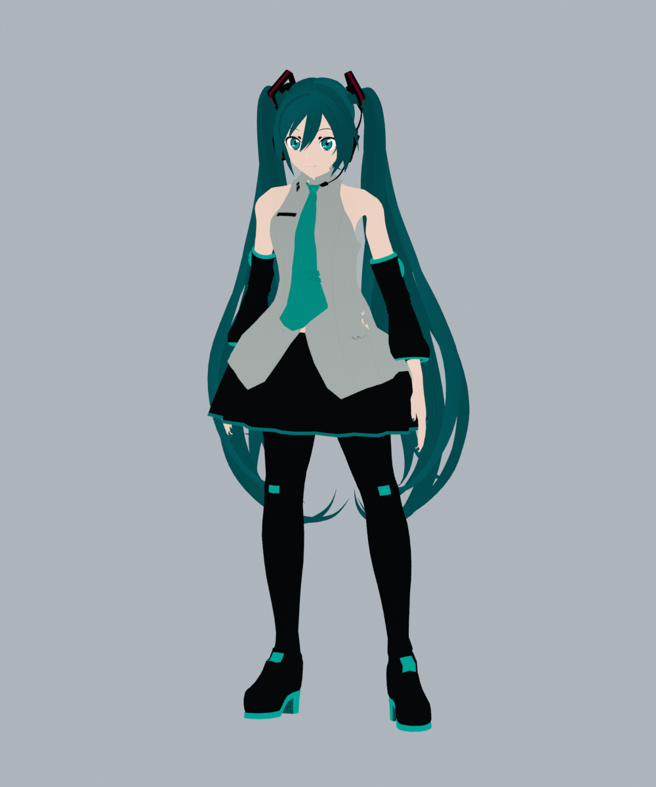
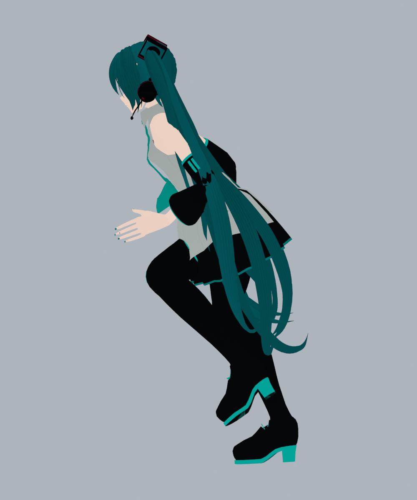
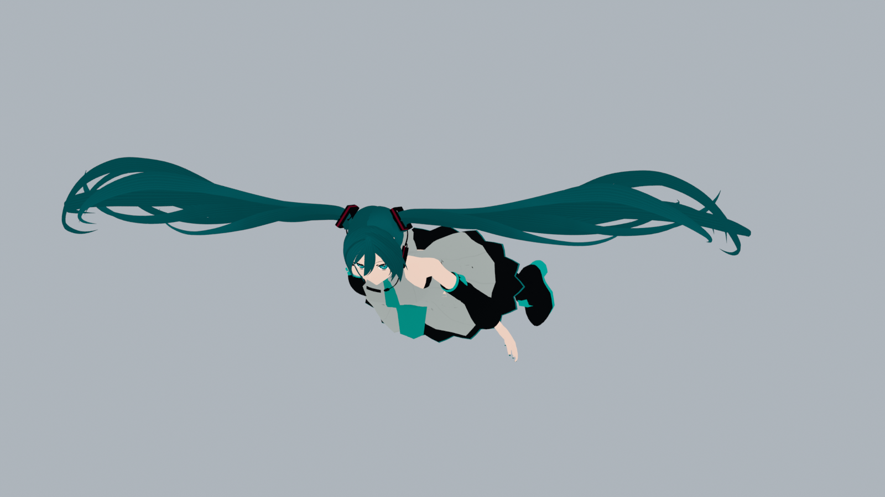
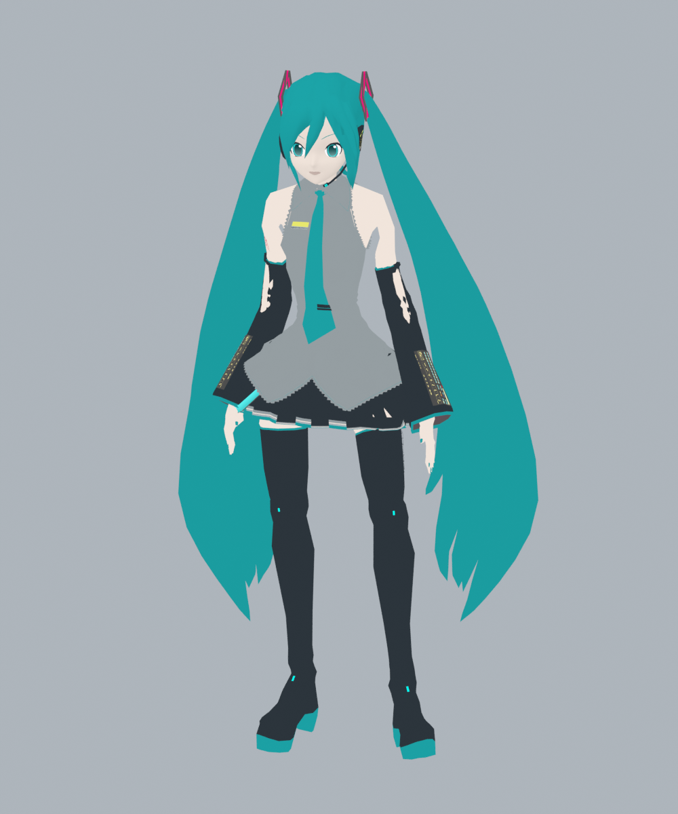
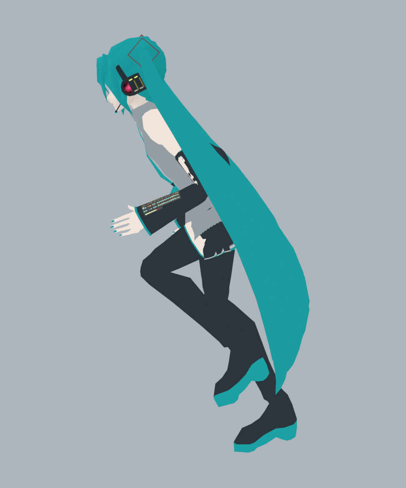
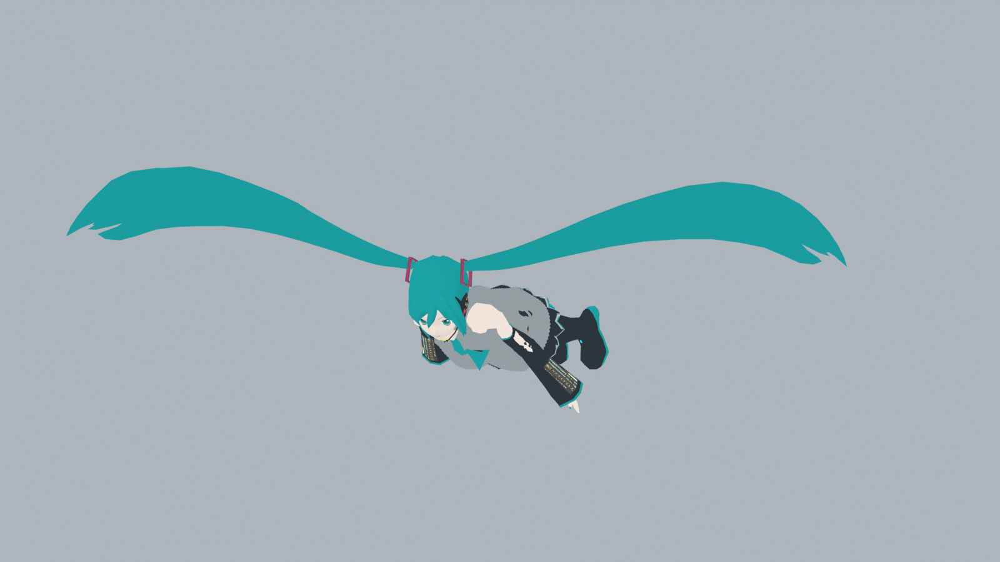

# Miku Glider artwork

Three skins, shown idle, running from the side, and in flight. These are model renders, not gameplay screenshots.

## Hatsune Miku v1

## Hatsune Miku v2

## Hatsune Miku v3

## Icon

Promotional artwork based on Hatsune Miku v1. [Full-size artwork](miku-icon-full.png).

[Model credits](../ATTRIBUTION.md)
